## Selected work

[GitHub](https://github.com/aryan99dev) · [Portfolio repository](https://github.com/aryan99dev/Portfolio) · [Business email](mailto:aryan99dev00@gmail.com)

<!-- Cards are generated by scripts/render_cards.py. Edit FEATURED and visual settings there. -->
